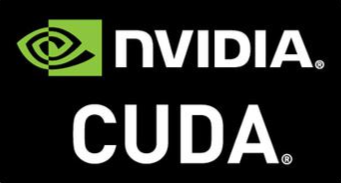

# Hi, welcome to my GitHub!!

 
Hello I´am Ángel Sanz Gutiérrez, an AI Engineer apasionated about creating AI models to solve problems.

 

I see artificial intelligence not just as a tool to tackle humanity’s greatest challenges, but as an ally that, guided by ethics and human values, can drive technology toward collective good and progress.

 

# 👨‍💻 About Me:

<table>
  <tr>
    <td valign="top" style="padding-right:12px; font-size:22px;"> 🎓 </td>
    <td>
      <strong>Education:</strong> 
      Graduate of the Public University of Navarra with a degree in Computer Engineering, specializing in Computing and Intelligent Systems.  
      Currently pursuing a master's degree in Artificial Intelligence at the Polytechnic University of Madrid.  
    </td>
  </tr>
  <tr>
    <td valign="top" style="padding-right:12px; font-size:22px;"> 🔬 </td>
    <td>
      <strong>Research interests:</strong> 
      Reinforcement Learning. Deep Learning. LLM. AI algorithm optimization
    </td>
  </tr>
</table>

 

# 🌐 Socials:

  
  

# 💻 Tech Stack:

### Programming Languages:

### AI/ML Tools:

### Deep Learning Frameworks:

### Development Tools:

### Video Games Development:

### What I am currently learning / improving on:

 

# 📊 GitHub Stats:
 

